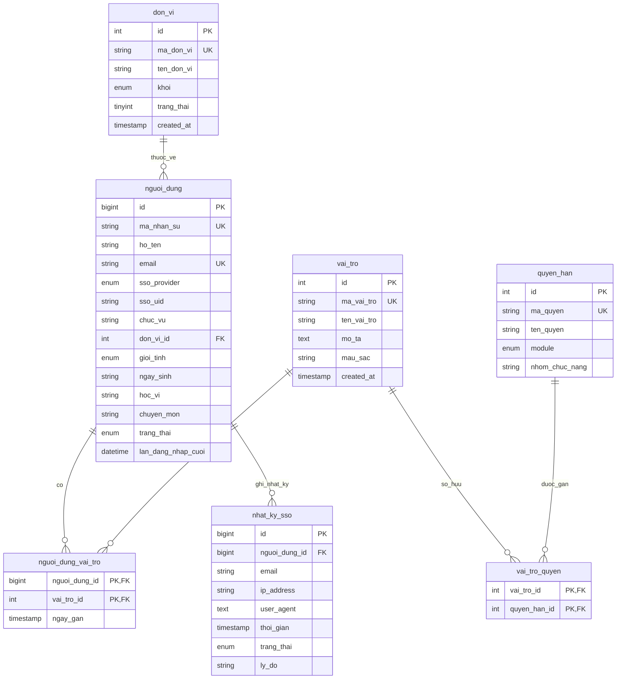

# TÀI LIỆU KIẾN TRÚC CƠ SỞ DỮ LIỆU (DATABASE ARCHITECTURE)
## HỆ THỐNG QUẢN LÝ THANH TOÁN THÙ LAO & GIỜ GIẢNG - TRƯỜNG ĐẠI HỌC TÂY ĐÔ (TDU)

> **Cơ sở dữ liệu:** `tdu_thantoan_db`  
> **Hệ quản trị CSDL:** MySQL / MariaDB (UTF-8 Unicode `utf8mb4_unicode_ci`)  
> **Kiến trúc phân quyền:** Mô hình RBAC (Role-Based Access Control) đa tầng đến mức Hành động (Action-Level) & Hỗ trợ Đa vai trò / Kiêm nhiệm.

---

## 1. TỔNG QUAN HỆ THỐNG VÀ SƠ ĐỒ THỰC THỂ (ERD)

Kiến trúc CSDL được thiết kế gồm **7 bảng chuẩn hóa**, kết nối chặt chẽ và đảm bảo toàn vẹn dữ liệu:



---

## 2. CHI TIẾT TỪNG BẢNG VÀ CÁC TRƯỜNG DỮ LIỆU (DATA DICTIONARY)

### 2.1. Bảng `don_vi` (Danh mục Đơn vị / Khoa / Phòng ban)
Lưu trữ danh sách 26 đơn vị chính thức của Trường Đại học Tây Đô.

| Tên biến / Cột | Kiểu dữ liệu | Khóa | Mặc định | Ý nghĩa & Mô tả |
| :--- | :--- | :---: | :---: | :--- |
| `id` | `INT(11)` | **PK** | AUTO_INC | Mã định danh duy nhất của đơn vị (1..26). |
| `ma_don_vi` | `VARCHAR(50)` | **UNI** | *None* | Ký hiệu viết tắt của đơn vị (VD: `CNTT`, `DT`, `KCB`, `KLUAT`). |
| `ten_don_vi` | `VARCHAR(255)`| | *None* | Tên chính thức (VD: *Phòng Công nghệ thông tin*, *Khoa Luật*). |
| `khoi` | `ENUM(...)` | | `'KHOA'` | Phân loại khối: `'KHOA'`, `'PHONG_BAN'`, `'TRUNG_TAM'`, `'DOAN_THE'`. |
| `trang_thai` | `TINYINT(1)` | | `1` | Trạng thái hoạt động: `1` = Hoạt động, `0` = Tạm khóa. |
| `created_at` | `TIMESTAMP` | | `CURRENT_TIMESTAMP` | Thời điểm tạo bản ghi. |

---

### 2.2. Bảng `nguoi_dung` (Hồ sơ Cán bộ & Giảng viên)
Lưu trữ hồ sơ toàn bộ 245 cán bộ, giảng viên, nhân viên của Nhà trường.

| Tên biến / Cột | Kiểu dữ liệu | Khóa | Mặc định | Ý nghĩa & Mô tả |
| :--- | :--- | :---: | :---: | :--- |
| `id` | `BIGINT(20)` | **PK** | AUTO_INC | ID định danh duy nhất của người dùng trong hệ thống. |
| `ma_nhan_su` | `VARCHAR(50)` | **UNI** | *None* | Mã cán bộ/Mã giảng viên chuẩn TDU (VD: `01060054`, `01067016`). |
| `ho_ten` | `VARCHAR(150)`| | *None* | Họ và tên đầy đủ (VD: *Lê Vũ Linh*, *Mai Nhựt Long*). |
| `email` | `VARCHAR(150)`| **UNI** | *None* | Email công vụ TDU (VD: `lvlinh@tdu.edu.vn`, `mnlong@tdu.edu.vn`). |
| `sso_provider`| `ENUM(...)` | | `'GOOGLE'` | Nền tảng xác thực: `'GOOGLE'`, `'MICROSOFT'`, `'LOCAL'`. |
| `sso_uid` | `VARCHAR(255)`| **INDEX**| `NULL` | Mã định danh người dùng từ Google SSO. |
| `avatar_url` | `VARCHAR(500)`| | `NULL` | Đường dẫn ảnh đại diện cá nhân. |
| `chuc_vu` | `VARCHAR(100)`| | `'Giảng viên'` | Chức vụ công tác (VD: *Giảng viên*, *Trưởng khoa*, *Chuyên viên*). |
| `don_vi_id` | `INT(11)` | **FK** | `NULL` | Liên kết đến `don_vi.id` (Đơn vị công tác chính). |
| `gioi_tinh` | `ENUM('Nam','Nữ')` | | `'Nam'` | Giới tính cán bộ. |
| `ngay_sinh` | `VARCHAR(20)` | | `NULL` | Ngày tháng năm sinh (Định dạng: `dd/mm/yyyy`). |
| `hoc_ham` | `VARCHAR(50)` | | `NULL` | Học hàm phong tặng: *GS*, *PGS*. |
| `hoc_vi` | `VARCHAR(50)` | | `'Thạc sĩ'` | Học vị đào tạo cao nhất: *Cử nhân*, *ThS*, *TS*, *TSKH*. |
| `chuyen_mon` | `VARCHAR(255)`| | `NULL` | Ngành nghề chuyên môn tốt nghiệp. |
| `nam_tot_nghiep`| `INT(11)` | | `NULL` | Năm tốt nghiệp văn bằng cao nhất. |
| `nam_tuyen_dung`| `INT(11)` | | `NULL` | Năm bắt đầu công tác tại Trường. |
| `ngay_ky_hdld`| `VARCHAR(20)` | | `NULL` | Ngày ký Hợp đồng Lao động chính thức. |
| `ccsp` | `VARCHAR(50)` | | `'Đã có'` | Chứng chỉ sư phạm giảng dạy đại học. |
| `anh_van` | `VARCHAR(50)` | | `'B2'` | Trình độ ngoại ngữ chuẩn khung năng lực (A2, B1, B2, C1). |
| `tin_hoc` | `VARCHAR(100)`| | `'Ứng dụng CNTT Nâng cao'` | Trình độ tin học. |
| `kiem_nhiem` | `VARCHAR(255)`| | `NULL` | Chức vụ kiêm nhiệm (nếu có). |
| `don_vi_kiem_nhiem`| `VARCHAR(255)`| | `NULL` | Đơn vị kiêm nhiệm công tác. |
| `trang_thai` | `ENUM(...)` | | `'HOAT_DONG'`| Trạng thái: `'HOAT_DONG'`, `'KHOA'`, `'NGHI_VIEC'`. |
| `lan_dang_nhap_cuoi`| `DATETIME` | | `NULL` | Thời điểm đăng nhập gần nhất vào hệ thống. |
| `created_at` | `TIMESTAMP` | | `CURRENT_TIMESTAMP` | Thời điểm tạo hồ sơ. |
| `updated_at` | `TIMESTAMP` | | `CURRENT_TIMESTAMP` | Thời điểm cập nhật hồ sơ gần nhất. |

---

### 2.3. Bảng `vai_tro` (Danh mục Nhóm Vai trò)
Lưu trữ danh sách 28 vai trò được tổ chức chuẩn hóa theo cơ cấu quản lý trường.

| Tên biến / Cột | Kiểu dữ liệu | Khóa | Mặc định | Ý nghĩa & Mô tả |
| :--- | :--- | :---: | :---: | :--- |
| `id` | `INT(11)` | **PK** | AUTO_INC | ID vai trò (1: Quản trị viên, 5: Phòng Đào tạo, 7: Giảng viên...). |
| `ma_vai_tro` | `VARCHAR(50)` | **UNI** | *None* | Mã code vai trò (VD: `QUAN_TRI_VIEN_HE_THONG`, `GIANG_VIEN`). |
| `ten_vai_tro` | `VARCHAR(150)`| | *None* | Tên hiển thị (VD: *Quản trị viên hệ thống*, *Phòng Quản lý Đào tạo*). |
| `mo_ta` | `TEXT` | | `NULL` | Mô tả trách nhiệm và phạm vi nghiệp vụ của vai trò. |
| `mau_sac` | `VARCHAR(20)` | | `'#2563eb'` | Mã màu HEX đại diện trên giao diện (Badge & Dot color). |
| `created_at` | `TIMESTAMP` | | `CURRENT_TIMESTAMP` | Thời điểm tạo vai trò. |

---

### 2.4. Bảng `quyen_han` (Danh mục 88 Quyền hạn chi tiết)
Định nghĩa từng hành động nhỏ (Xem, Thêm, Sửa, Xóa, Import, Khóa kỳ, v.v.) chia theo 7 phân hệ module.

| Tên biến / Cột | Kiểu dữ liệu | Khóa | Mặc định | Ý nghĩa & Mô tả |
| :--- | :--- | :---: | :---: | :--- |
| `id` | `INT(11)` | **PK** | AUTO_INC | ID quyền hạn (1..88). |
| `ma_quyen` | `VARCHAR(80)` | **UNI** | *None* | Mã quyền thao tác (VD: `gg_them_moi`, `gg_xoa`, `nckh_bb_export`). |
| `ten_quyen` | `VARCHAR(255)`| | *None* | Tên mô tả hành động (VD: *Thêm mới bản ghi giờ giảng*). |
| `module` | `ENUM(...)` | | *None* | Module trực thuộc: `'THANH_TOAN_GIO_GIANG'`, `'NGHIEN_CUU_KHOA_HOC'`, `'CONG_TAC_KHAC'`, `'THANH_TOAN'`, `'TRA_CUU_PHAN_HOI'`, `'BAO_CAO'`, `'HE_THONG'`. |
| `nhom_chuc_nang`| `VARCHAR(150)`| | `NULL` | Phân nhóm con trong module (VD: *Kê khai giờ giảng*, *Bài báo*, *Seminar*). |

---

### 2.5. Bảng `nguoi_dung_vai_tro` (Gán Người dùng $\leftrightarrow$ Vai trò)
Bảng liên kết Nhiều - Nhiều cho phép 1 người dùng sở hữu nhiều vai trò cùng lúc (kiêm nhiệm).

| Tên biến / Cột | Kiểu dữ liệu | Khóa | Ràng buộc | Ý nghĩa & Mô tả |
| :--- | :--- | :---: | :---: | :--- |
| `nguoi_dung_id` | `BIGINT(20)` | **PK, FK** | `nguoi_dung(id)` ON DELETE CASCADE | ID người dùng được cấp vai trò. |
| `vai_tro_id` | `INT(11)` | **PK, FK** | `vai_tro(id)` ON DELETE CASCADE | ID vai trò được gán cho người dùng. |
| `ngay_gan` | `TIMESTAMP` | | `CURRENT_TIMESTAMP` | Thời điểm bắt đầu gán vai trò. |

---

### 2.6. Bảng `vai_tro_quyen` (Gán Vai trò $\leftrightarrow$ Quyền hạn chi tiết)
Bảng liên kết Nhiều - Nhiều quyết định vai trò nào được thực thi những quyền hạn nào.

| Tên biến / Cột | Kiểu dữ liệu | Khóa | Ràng buộc | Ý nghĩa & Mô tả |
| :--- | :--- | :---: | :---: | :--- |
| `vai_tro_id` | `INT(11)` | **PK, FK** | `vai_tro(id)` ON DELETE CASCADE | ID nhóm vai trò. |
| `quyen_han_id`| `INT(11)` | **PK, FK** | `quyen_han(id)` ON DELETE CASCADE| ID quyền hạn chi tiết được trao cho vai trò. |

---

### 2.7. Bảng `nhat_ky_sso` (Lịch sử Đăng nhập qua Email TDU)
Ghi nhận toàn bộ vết truy cập và phiên đăng nhập SSO để phục vụ kiểm toán an ninh hệ thống.

| Tên biến / Cột | Kiểu dữ liệu | Khóa | Mặc định | Ý nghĩa & Mô tả |
| :--- | :--- | :---: | :---: | :--- |
| `id` | `BIGINT(20)` | **PK** | AUTO_INC | ID nhật ký truy cập. |
| `nguoi_dung_id` | `BIGINT(20)` | **FK** | `NULL` | ID người dùng đăng nhập. |
| `email` | `VARCHAR(150)`| | *None* | Email đăng nhập vào hệ thống. |
| `ip_address` | `VARCHAR(50)` | | `NULL` | Địa chỉ IP của máy truy cập. |
| `user_agent` | `TEXT` | | `NULL` | Thông tin trình duyệt và thiết bị truy cập. |
| `thoi_gian` | `TIMESTAMP` | | `CURRENT_TIMESTAMP`| Thời điểm phát sinh sự kiện đăng nhập. |
| `trang_thai` | `ENUM(...)` | | `'THANH_CONG'` | Kết quả: `'THANH_CONG'` hoặc `'THAT_BAI'`. |
| `ly_do` | `VARCHAR(255)`| | `NULL` | Lý do thất bại (nếu có). |

---

## 3. CƠ CHẾ VẬN HÀNH PHÂN QUYỀN (RBAC LOGIC)

### 3.1. Nguyên tắc Cộng dồn quyền (Union Permissions)
Khi một cán bộ đăng nhập (Ví dụ: Thầy `Lê Vũ Linh` vừa là *Giảng viên*, vừa là *Quản trị viên hệ thống*):
$$\text{Tập quyền của người dùng} = \bigcup_{v \in \text{Vai trò của người dùng}} \text{Quyền}(v)$$
Hệ thống sử dụng câu lệnh SQL sau để lấy danh sách quyền hạn thực tế:
```sql
SELECT DISTINCT q.ma_quyen
FROM quyen_han q
INNER JOIN vai_tro_quyen vq ON q.id = vq.quyen_han_id
INNER JOIN nguoi_dung_vai_tro uv ON vq.vai_tro_id = uv.vai_tro_id
WHERE uv.nguoi_dung_id = :currentUserId;
```

### 3.2. Kiểm soát 2 tầng (Giao diện UI & Máy chủ API)
1. **Tại Frontend (UI):** Các nút bấm (Thêm mới, Sửa, Xóa, Import Excel, Khóa kỳ) kiểm tra:
   ```tsx
   {userPermissions.includes('gg_them_moi') && <ButtonAdd />}
   ```
2. **Tại Backend (Server API):** Middleware kiểm tra quyền trước khi thực thi truy vấn:
   ```typescript
   if (!user.permissions.includes('gg_them_moi')) {
     return res.status(403).json({ error: 'Không có quyền thêm mới giờ giảng!' });
   }
   ```

---

## 4. TỔNG KẾT
Kiến trúc CSDL `tdu_thantoan_db` đảm bảo:
* **Tính chuẩn hóa (3NF):** Tối ưu hóa dung lượng lưu trữ, không dư thừa dữ liệu.
* **Toàn vẹn dữ liệu (Referential Integrity):** Sử dụng các khóa ngoại `ON DELETE CASCADE` giúp đồng bộ dữ liệu tự động khi có điều chỉnh.
* **Khả năng mở rộng:** Dễ dàng bổ sung tính năng mới chỉ bằng cách thêm dòng vào bảng `quyen_han` mà không cần thay đổi cấu trúc bảng.
